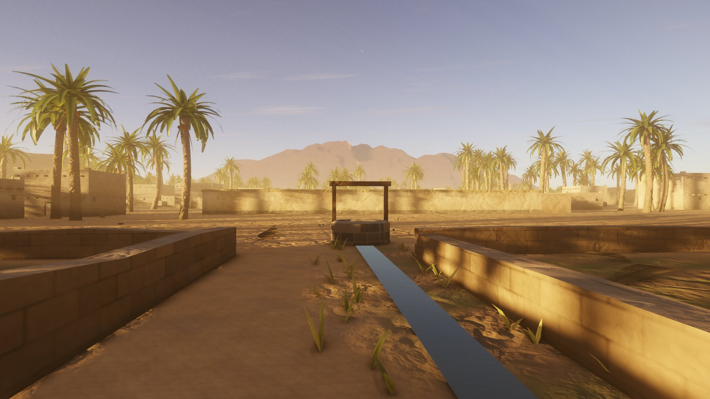
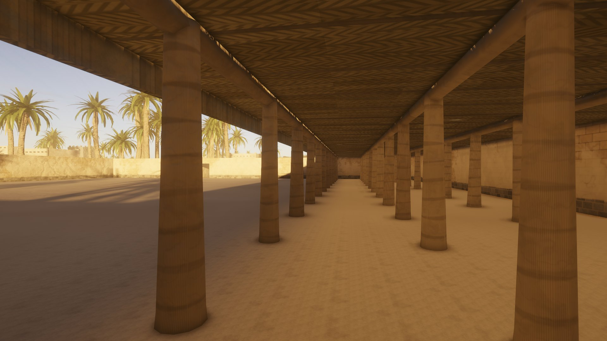
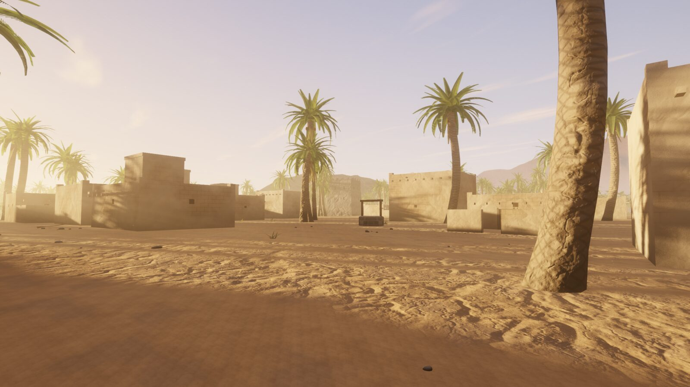
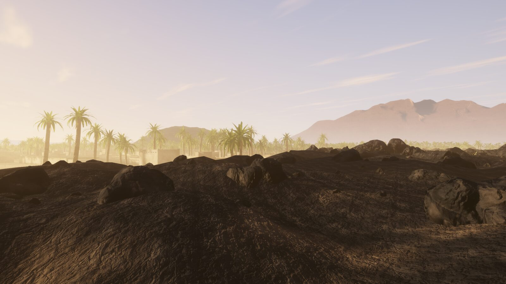
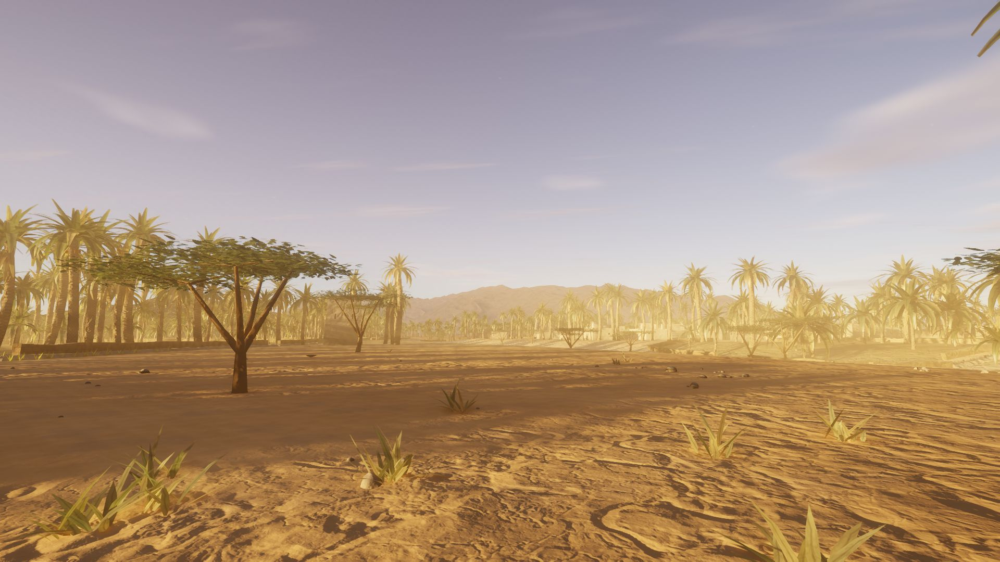
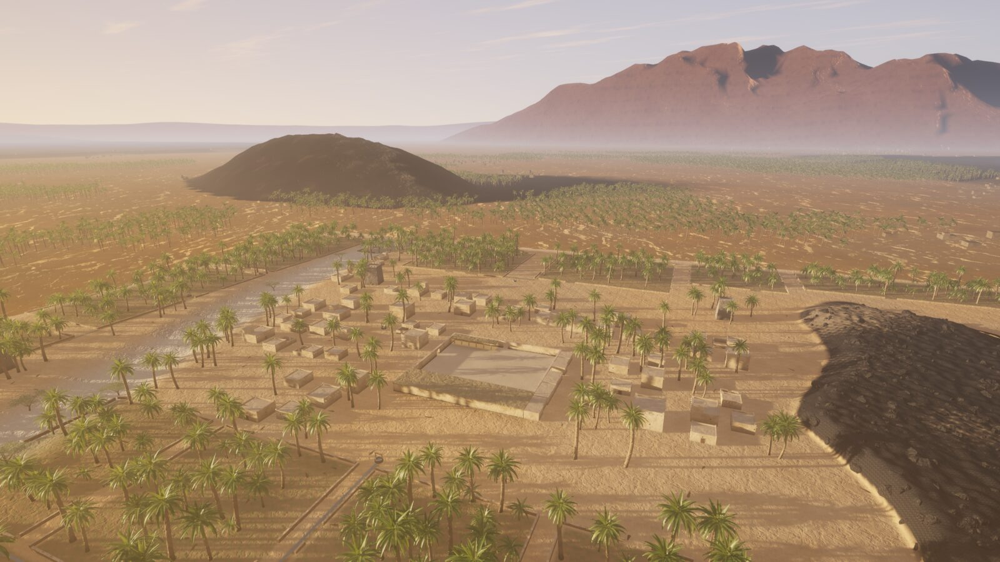

# Madinah, First Years

<p align="center">
  <a href="https://moeymakes.github.io/madinah-first-years/"></a>
</p>
<p align="center"><b><a href="https://moeymakes.github.io/madinah-first-years/">moeymakes.github.io/madinah-first-years/</a></b><br>
<sub>Chrome or Edge on a desktop or laptop (needs WebGPU) · nothing to install · one HTML file</sub></p>

**Walk through the oasis of Madinah as it may have looked around 622-632 CE, in the low evening light, right in your browser.**

Date-palm groves inside mud-brick garden walls, wells and earthen ditches, flat-roofed houses and square stone
tower-houses, the black lava of the harrat, a sandy wadi with acacias, and at the heart of it a very simple
mosque: mud-brick walls on a stone footing, an open earth courtyard, and a prayer hall of palm-trunk columns under
a roof of palm fronds. Mount Uhud closes the northern horizon. Everything is made by code: no images, no 3D models,
no sound files. The whole world is **one HTML file** of about 100 KB.

**This is an artistic reconstruction, not an exact one.** The sources agree on the materials and the rough size of
the first mosque, and on the lava fields, the wadis and Uhud around the oasis. Most other details are informed guesses:
how high the walls stood, how many columns there were, what the houses and tower-houses looked like, where the
settlements lay. The geography is composed and compressed so it fits in one view. Sources, and which details are
guesses, are listed in [NOTES.md](NOTES.md).

There are no people in the scene and no animals except a few birds. The rooms of the Prophet's ﷺ household are shown
only as plain closed walls. Nothing is recited, and there is no text from scripture anywhere in the world.

[](https://moeymakes.github.io/madinah-first-years/)

| | |
|---|---|
|  |  |
|  |  |



## Try it

1. Open **[https://moeymakes.github.io/madinah-first-years/](https://moeymakes.github.io/madinah-first-years/)** in **Chrome** or **Edge** on a desktop computer, or download
   [`index.html`](index.html) and open it from your computer (it works offline).
3. Wait a few seconds while the land is built, then press **Enter** and start walking.

It works offline. It needs a browser with **WebGPU**.

## What's there

- **The first mosque**: a 50 m square enclosure (its size after the expansion of 7 AH) with gates on the north, east
  and west, three rows of palm-trunk columns carrying a roof of palm fronds on the qibla side, the shaded Suffah at
  the back, and a courtyard of trodden earth and pebbles. No minaret, no dome.
- **The household rooms** against the east wall, as plain low closed rooms
- **Date palms** in walled gardens, with date clusters and fallen fronds, wells with wooden frames, earthen ditches
- **Houses** of mud brick with flat roofs, parapets, palm-beam ends and plank doors, and **utum**, the square stone
  tower-houses of the clans
- **The harrat**: a lobe of black basalt at the eastern edge, more lava fields and cinder cones beyond
- **Wadi al-Aqiq** in the west: pale sand, cobbles, acacias
- **On the horizon**: Mount Uhud to the north, Jabal Sal' close to the north-west, Jabal Ayr to the south, a small
  early mosque at Quba among the southern groves
- **Life**: a few doves circling, dust drifting in the low sun
- **Sound** made up as you listen: wind and gusts, rustling fronds, doves, small birds

## Controls

| | Keyboard & mouse |
|---|---|
| Look around | Move the mouse (or drag with the left button where the mouse cannot be captured) |
| Walk | `W` `A` `S` `D` |
| Run | Hold `Shift` |
| Fly / walk | `F`, or `E` to lift off from walking |
| Up / down | `E` / `Q` (descending onto the ground lands you back to walking) |
| Jump to a viewpoint | `1` to `6` |
| Menu | `Esc` |
| Sound on / off | `M` |
| Performance stats | `H` |
| Detail level | **Low**, **Medium** or **High** in the menu (reloads the page) |

**On a touchscreen:** hold one finger down to walk forward and slide it to look around; a second finger runs;
the ✈ button toggles flight.

## How it works

- The ground model (heights, lava, wadi, hills, hamlets and groves) is one function evaluated on the graphics card when
  the page opens: at 1 m over the walkable land and at about 23 m over 24 km of surroundings.
- The walkable land is a 3D density field turned into a mesh, so the basalt can be blocky and broken.
- The far landscape is a ring-shaped mesh out to 12 km with soft shadows baked from the low sun.
- Palm fronds are built in the vertex shader; their leaflets are cut out per pixel and anti-aliased with
  alpha-to-coverage. The mosque roof, bark, brick and stone are drawn by the shaders, not stored as pictures.
- Everything is drawn with **WebGPU** directly. No engine or 3D library.
- The engine started from the author's earlier world, Madinah Horizon; the method, the verification loop and the
  page structure follow [Abyssal Garden](https://github.com/noniv/abyssal-garden) (MIT).

## Make it your own

Source is in [`source`](source). Rebuild with Node.js 18+:

```bash
cd source && npm install && npm run build
```

| File | What's inside |
|---|---|
| [`source/src/world.js`](source/src/world.js) | Layout: the mosque, houses, tower-houses, gardens, ditches, wells, palms, rocks, birds, viewpoints and the camera path |
| [`source/src/shaders.js`](source/src/shaders.js) | The ground model, sky and haze, materials (mud brick, stone, thatch, bark), palm fronds, sun shafts and the final image |
| [`source/src/main.js`](source/src/main.js) | Renderer, walking and flying, collision, controls |
| [`source/src/audio.js`](source/src/audio.js) | The soundscape |
| [`source/src/quality.js`](source/src/quality.js) | Detail levels |
| [`source/template.html`](source/template.html) | The page: loading bar, menu, controls list |

`npm run build:dev` writes `dev.html` with a scripted one-minute flight (`P`) and a benchmark (`B`).

## Other worlds in this series

- **[Madinah Horizon](https://moeymakes.github.io/madinah-horizon/)**: the date gardens, lava fields and hills around Madinah at golden hour, with the Prophet's Mosque and Uhud on the horizon ([source](https://github.com/moeymakes/madinah-horizon))
- **[Nabawi Courtyard](https://moeymakes.github.io/masjid-nabawi-courtyard/)**: the marble plaza of the Prophet's Mosque up close, as the great umbrellas open ([source](https://github.com/moeymakes/masjid-nabawi-courtyard))

## Data sources

- **Elevation**: the relief of Uhud, Jabal Ayr and Jabal Sal' comes from the Copernicus GLO-30 Digital Elevation
  Model (© DLR e.V. 2010-2014 and © Airbus Defence and Space GmbH 2014-2018, provided under COPERNICUS by the European
  Union and ESA; free and open). It is packed into `source/src/data.js` by `source/tools/pack-data.py`, and only relief
  well above the plain is used, so no modern building in the surface model reaches the world.
- **Wadi al-Aqiq's course**: © [OpenStreetMap](https://www.openstreetmap.org/copyright) contributors, available under
  the [Open Database License (ODbL)](https://opendatacommons.org/licenses/odbl/). Ways 960090164 and 1235902746,
  resampled into `source/src/data.js`.
- **Colours** were checked against public photographs of Uhud and Harrat Rahat on Wikimedia Commons, measured only;
  no photograph is part of the page.

The geography is composed, not to scale: each real feature keeps its shape but sits where the composition puts it.

## License

MIT, copyright Mohammed El-Cheikh 2026. Parts adapted from Abyssal Garden (MIT); its notice is in
`source/LICENSE-abyssal-garden`.
